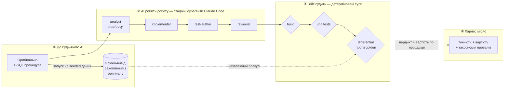
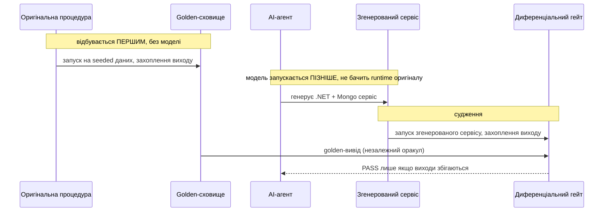

# sql-to-service

**Інженерний харнес, який робить ненадійний AI придатним до довіри на реальній
міграційній задачі.**

> 🖥️ **[Інтерактивний гайд → viacheslavmelnichenko.github.io/sql-to-service](https://viacheslavmelnichenko.github.io/sql-to-service/)** —
> покроковий тур усім харнесом. Кожен крок парує команду з виводом, що доводить
> її спрацювання.

Задача — конверсія легасі T-SQL збережених процедур у сервісний шар .NET +
MongoDB — це *вехікл*, а не суть. Будь-хто може попросити мовну модель перекласти
код. Цікава проблема — та, з якою кожна команда стикається щойно намагається
*задеплоїти* написане моделлю: **модель впевнено помиляється достатньо часто, щоб
не можна було довіряти її виходу без незалежного способу її зловити.**

Це репо і є той незалежний спосіб. Воно побудоване **на Claude Code**, на його
нативних примітивах — субагентах, скілах, хуках і тулах — тож «AI-інженерія» тут —
реальний механізм платформи, а не скрипт-обгортка, що вдає агента.

> **Статус:** гейт і пайплайн побудовані й відтворювані вже сьогодні;
> пререєстрований розподіл евалів частково зібрано (k=1 з k=3). У проєкті живе два
> види чисел, і різниця між ними — уся суть:
> - **Результати гейта** існують сьогодні й відтворювані за $0 без виклику моделі
>   — три сконвертовані процедури проходять свій диференціал (10/10 кейсів, вкл.
>   decimal-процедуру і двоплечий темпоральний джойн), мутаційна перевірка ловить
>   12/12 упорснутих багів по всіх трьох (вкл. мутант точності `decimal→double`),
>   оракул стабільний по 67 golden-файлах. Запусти `gates/verify.sh` +
>   `gates/mutation-check.sh` — і відтвориш їх сам;
>   [гайд](https://viacheslavmelnichenko.github.io/sql-to-service/) показує кожен у
>   парі з його командою.
> - **Числа евалів** — точність по всьому корпусу, вартість на процедуру,
>   таксономія провалів — **почали** лягати: харнес Фази 4 (`evals/harness.py`)
>   породив свій перший живий семпл (`run-001.sample-01.json` — три процедури,
>   $2.84–$4.39 кожна, усі пройшли), але це **k=1 з пререєстрованих k=3**, тож
>   корпусний розподіл ще осідає. Там, де число ще не виміряне, цей документ прямо
>   це каже, а не показує плейсхолдер.

---

## Що це доводить

Не «AI вміє конвертувати SQL». Вміє. Це доводить те, що насправді має значення:

> *Я не прошу модель конвертувати код — я будую систему, яка дозволяє **довіряти**
> ненадійній моделі на міграційній роботі: незалежний оракул, що ловить її
> помилки, і вимірювання, що це доводить.*

Три речі несуть цю тезу:

1. **Нециклічний гейт.** Оракул коректності захоплено з *оригінальної* процедури
   **до того, як запустилася будь-яка модель**, тож AI не може змовитися з тим, що
   його судить.
2. **Агентна інженерія, не промпт.** Стадійні субагенти з розділеним контекстом,
   керовані скілами, загейтовані хуками — так, як реально будують продакшн-агента.
3. **Чесне вимірювання.** Харнес (`evals/harness.py`, Фаза 4 — працює зараз, з
   першим живим семплом усередині) ганяє реального агента headless по кожній
   процедурі й звітує точність *і* вартість, включно з провалами — бо результат без
   провалів це привід розслідувати, а не перемога (перший семпл зі sweep'ом 3/3
   трактується саме так, у `evals/results/summary.md`). Дизайн свідомо *не* заявляє
   корпусних чисел, доки повний розподіл k=3 не завершиться.

---

## Флоу, наскрізь



Читай як одне речення:

> **Golden захоплено до AI → субагенти роблять роботу стадійно → хуки гейтять
> кожен перехід через детерміновані тули → харнес міряє чесно.**

Гейт — несуча ідея. *Власні* згенеровані агентом тести самі гейт не проходять —
вони можуть помилятися в тому ж напрямку, що й код. Лише **диференціал** — вивід
згенерованого сервісу, порівняний значення-за-значенням, після канонікалізації, з
golden-виходом, захопленим до існування моделі — має право сказати «ця конверсія
коректна». (Канонікалізація означає, що десяткові рендеряться з фіксованим
масштабом, а ключі об'єктів відсортовані — тож косметична різниця в представленні
ніколи не маскує й не імітує справжню.)

---

## Чому гейт нециклічний

Failure mode кожного демо «AI протестував власну роботу» — циклічність: модель
пише код *і* тести, тож тести кодують те саме нерозуміння, що й код, і обидва
згодні, поки обидва помиляються.



Оскільки golden-вивід заморожено до старту агента, немає шляху, яким модель могла
б вплинути на оракул. Оракул — це факт про *оригінальну систему*, а не думка, яку
модель допомогла сформувати.

Ще один запобіжник: Mongo-бік порівняння засівається **фіксованим, закоміченим**
міграційним кодом — чистою функцією від реляційного seed, написаною до будь-якої
конверсії — тож ми не переносимо тихо проблему оракула в підігнаний вручну
документний store.

---

## Побудовано на Claude Code — чотири примітиви

Ось де «AI-інженерія» перестає бути слоганом. Кожна стадія пайплайну — реальний
механізм Claude Code, а не перейменована функція. Відкрийте `.claude/` — і, якщо
ви знаєте Claude Code, впізнаєте примітиви з першого погляду.

| Примітив | Де живе | Що доводить |
| --- | --- | --- |
| **Субагенти** | `.claude/agents/{analyst,implementer,test-author,reviewer}.md` | Розділення контексту вбудоване, не імітоване. `analyst` — read-only і пише специфікацію; `test-author` пише тести, не бачачи, що було зручно `implementer`. |
| **Скіли** | `.claude/skills/*` | Знання конверсії живе у версіонованих файлах, які перевіряє `reviewer` — не в ефемерному промпті. |
| **Хуки** | `.claude/settings.json` | `PostToolUse` білдить після кожного запису; `Stop` ганяє диференціал до того, як агент завершиться; `PreToolUse` блокує записи поза дозволеними теками. Гейти працюють *у потоці*, не постфактум. |
| **Тули** | `gates/*.sh` (Bash зараз; MCP-сервер — запланований stretch) | Гейт — детермінований тул, який агент *викликає*; модель ніколи не оцінює себе. |

Харнес ганяє Claude Code **headless** (`claude -p …`) раз на процедуру й збирає
реальну вартість токенів з кожного прогону. Headless-цикл породив свій **перший
живий семпл** (`run-001.sample-01.json`) — три процедури наскрізь реальним агентом,
кожна пройшла проти замороженого golden — а пререєстрований розподіл **k=3** у
процесі (k=1 виміряно). Жодне число не подано як усталений корпусний результат,
доки той розподіл не завершиться.

---

## Відтворити (для того, хто запускає)

```sh
cp .env.example .env         # додай свій API-ключ моделі; .env gitignored
docker compose up -d         # SQL Server на :11433, MongoDB на :37017
./corpus/restore.sh          # відновлення + seed семпл-БД (пінований .bak, SHA-перевірка)
./gates/verify.sh            # build + unit + differential проти закоміченого виходу
                             #   → відтворює опубліковану таблицю, БЕЗ викликів моделі
bash evals/run.sh            # перевірка каркаса, без моделі, $0 (пише dry-run.json)
bash evals/run.sh --live     # опціонально, ПЛАТНО: перезапуск агента наскрізь
```

`verify.sh` — це аудит: він регенерує звітовані результати із закомічених
артефактів, не викликаючи жодної моделі. `evals/run.sh` за замовчуванням — **dry
run** (безкоштовно); `--live` — окрема, opt-in, платна команда. Повний операційний
runbook, і POSIX, і Windows, — [`evals/RUNNING.md`](evals/RUNNING.md).

Порти `11433` / `37017` нестандартні навмисно, щоб не колідувати з локальними SQL
Server чи MongoDB.

---

## Чим це *не* є

- **Не транспайлер.** Детермінований SQL→C# конвертер був би *менше* AI, не більше.
- **Не бенчмарк «наскільки добрий AI».** Він міряє, чи *харнес* ловить AI на помилці, і чого це коштує.
- **Не біографія.** Демонстраційний артефакт. Без реальних даних клієнта чи енгейджменту. Корпус — публічний MIT-семпл WideWorldImporters.
- **Застосовний не до кожної процедури.** Нециклічний оракул працює лише для процедур, які **тільки читають**, **детерміновані** і повертають **єдиний result set** (критерії включення з `corpus/SELECTION.md`). Процедури, що пишуть стан або гілкуються за годинником, потребують *іншого* харнеса. Репозиторій чесно закриває піддатливий тир і чітко каже, де той тир закінчується.

---

## Layout

```
.claude/            інженерія — субагенти, скіли, хуки (герой)
  agents/           analyst · implementer · test-author · reviewer
  skills/           стандарти конверсії, проти яких перевіряє reviewer
  settings.json     хуки, що гейтять кожен перехід
corpus/
  procs/            оригінальні T-SQL процедури (вхід)
  golden/           вивід, захоплений з оригіналів, до будь-якої моделі
  seed/             реляційний seed + фіксована міграція в Mongo-seed
  features/         детерміновані AST-картки фіч — обсервабельність, НЕ гейт (ADR-0008)
  extract-features.py  sqlglot-парсер, що видає ці картки ($0, без моделі)
gates/              build · unit · differential · verify (детерміновані тули)
                    features-check.sh — standalone; доводить, що картки не мають влади
generated/          що виробив агент (вихід вехікла)
evals/              харнес, метод і результати
docs/               архітектура і записи рішень (ADR)
demo/               покроковий гайд-воркшоп (відкрий demo/index.html)
```

---

## Документація

Усе, в порядку читання, зіндексовано в **[`docs/README.md`](docs/README.md)** —
архітектура, вісім ADR, протокол повторів пайплайну, пререєстрація евалів і
провенанс корпусу. Уперше тут? Воркшоп **[`demo/`](demo/)** — найшвидший вхід.

---

## Ліцензія

[MIT](LICENSE). Корпус — публічний MIT-ліцензований семпл WideWorldImporters
(див. [`corpus/SOURCE.md`](corpus/SOURCE.md)); цей репозиторій не несе реальних
даних клієнта, продукту чи енгейджменту.
