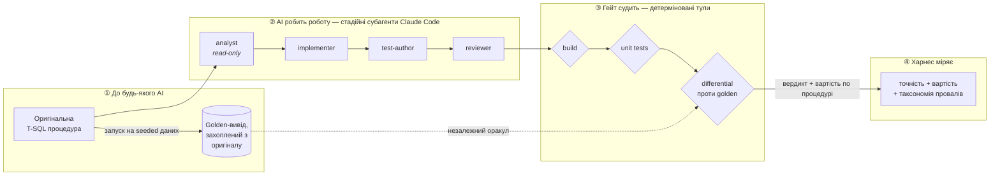
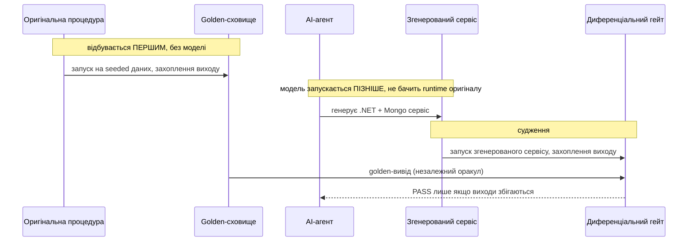
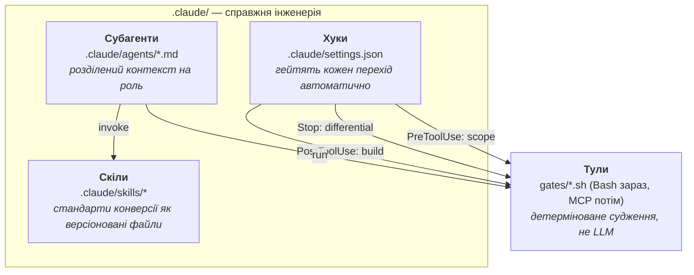

# sql-to-service

**Інженерний харнес, який робить ненадійний AI придатним до довіри на реальній
міграційній задачі.**

> 🖥️ **[Інтерактивний гайд → viacheslavmelnichenko.github.io/sql-to-service](https://viacheslavmelnichenko.github.io/sql-to-service/)** —
> покроковий тур усім харнесом. Кожен крок парує команду з виводом, що доводить
> її спрацювання.

Задача — конверсія легасі T-SQL збережених процедур у сервісний шар .NET +
MongoDB — це *вехікл*, а не суть. Будь-хто може попросити мовну модель перекласти
код. Цікава проблема — та, з якою кожна команда стикається щойно намагається
*задеплоїти* написане моделлю: **модель впевнено помиляється достатньо часто, щоб
не можна було довіряти її виходу без незалежного способу її зловити.**

Це репо і є той незалежний спосіб. Воно побудоване **на Claude Code**, на його
нативних примітивах — субагентах, скілах, хуках і тулах — тож «AI-інженерія» тут —
реальний механізм платформи, а не скрипт-обгортка, що вдає агента.

> **Статус:** дизайн завершено, імплементація в процесі. У проєкті живе два види
> чисел, і різниця між ними — уся суть:
> - **Результати гейта** існують уже сьогодні й відтворювані за $0 без жодного
>   виклику моделі — одна showcase-процедура проходить свій differential (5/5
>   кейсів), мутаційна перевірка ловить 5/5 упорснутих багів, оракул стабільний по
>   67 golden-файлах. Запусти `gates/verify.sh` + `gates/mutation-check.sh` — і
>   відтвориш їх сам; [гайд](https://viacheslavmelnichenko.github.io/sql-to-service/)
>   показує кожен у парі з його командою.
> - **Числа евалів** — точність по всьому корпусу, вартість на процедуру,
>   таксономія провалів — ще **не** існують. Вони приходять із харнесом Фази 4
>   (`evals/harness.py`), і там, де мало би стояти таке число, документ прямо це
>   каже, а не показує плейсхолдер.

---

## Що це доводить

Не «AI вміє конвертувати SQL». Вміє. Це доводить те, що насправді має значення:

> *Я не прошу модель конвертувати код — я будую систему, яка дозволяє **довіряти**
> ненадійній моделі на міграційній роботі: незалежний оракул, що ловить її
> помилки, і вимірювання, що це доводить.*

Три речі несуть цю тезу:

1. **Нециклічний гейт.** Оракул коректності захоплено з *оригінальної* процедури
   **до того, як запустилася будь-яка модель**, тож AI не може змовитися з тим, що
   його судить.
2. **Агентна інженерія, не промпт.** Стадійні субагенти з розділеним контекстом,
   керовані скілами, загейтовані хуками — так, як реально будують продакшн-агента.
3. **Чесне вимірювання.** Харнес (`evals/harness.py`, Фаза 4 — каркас працює вже
   сьогодні, живий вимір — наступний крок) побудовано так, щоб ганяти реального
   агента headless по кожній процедурі й звітувати точність *і* вартість, включно з
   провалами — бо результат без провалів це привід розслідувати, а не перемога. Дизайн
   свідомо *не* заявляє корпусних чисел, доки цей запуск не відбувся.

---

## Флоу, наскрізь



Читай як одне речення:

> **Golden захоплено до AI → субагенти роблять роботу стадійно → хуки гейтять
> кожен перехід через детерміновані тули → харнес міряє чесно.**

Гейт — несуча ідея. *Власні* згенеровані агентом тести самі гейт не проходять —
вони можуть помилятися в тому ж напрямку, що й код. Лише **диференціал** — вивід
згенерованого сервісу, порівняний значення-за-значенням, після канонікалізації, з
golden-виходом, захопленим до існування моделі — має право сказати «ця конверсія
коректна». (Канонікалізація означає, що десяткові рендеряться з фіксованим
масштабом, а ключі об'єктів відсортовані — тож косметична різниця в представленні
ніколи не маскує й не імітує справжню.)

---

## Чому гейт нециклічний

Failure mode кожного демо «AI протестував власну роботу» — циклічність: модель
пише код *і* тести, тож тести кодують те саме нерозуміння, що й код, і обидва
згодні, поки обидва помиляються.



Оскільки golden-вивід заморожено до старту агента, немає шляху, яким модель могла
б вплинути на оракул. Оракул — це факт про *оригінальну систему*, а не думка, яку
модель допомогла сформувати.

Ще один запобіжник: Mongo-бік порівняння засівається **фіксованим, закоміченим**
міграційним кодом — чистою функцією від реляційного seed, написаною до будь-якої
конверсії — тож ми не переносимо тихо проблему оракула в підігнаний вручну
документний store.

---

## Побудовано на Claude Code — чотири примітиви

Ось де «AI-інженерія» перестає бути слоганом. Кожна стадія пайплайну — реальний
механізм Claude Code, а не перейменована функція. Відкрийте `.claude/` — і, якщо
ви знаєте Claude Code, впізнаєте примітиви з першого погляду.



| Примітив | Де живе | Що доводить |
| --- | --- | --- |
| **Субагенти** | `.claude/agents/{analyst,implementer,test-author,reviewer}.md` | Розділення контексту вбудоване, не імітоване. `analyst` — read-only і пише специфікацію; `test-author` пише тести, не бачачи, що було зручно `implementer`. |
| **Скіли** | `.claude/skills/*` | Знання конверсії (як мапити `decimal` → `Decimal128`, як змоделювати result set як документ) живе у версіонованих файлах, які перевіряє `reviewer` — не в ефемерному промпті. |
| **Хуки** | `.claude/settings.json` | `PostToolUse` білдить після кожного запису; `Stop` ганяє диференціал до того, як агент може завершитись; `PreToolUse` блокує записи поза дозволеними теками. Гейти працюють *у потоці*, не постфактум. |
| **Тули** | `gates/*.sh` (Bash зараз; MCP-сервер — запланований stretch) | Гейт — детермінований тул, який агент *викликає*; модель ніколи не оцінює себе. |

Харнес побудовано так, щоб ганяти Claude Code **headless** (`claude -p …`) раз на
процедуру й збирати реальну вартість токенів з кожного прогону, тож звітовані числа
походитимуть зі справжніх запусків агента, а не з моків. Точно про те, що вже
запускалося: показову конверсію проведено крізь ці чотири стадії **вручну**, щоб
довести пайплайн end-to-end; headless-цикл, який робить це автономно, — наступний
крок харнесу, і жодне число тут не подано так, ніби той цикл його вже породив.

---

## Одна конверсія наскрізь

Репо спроєктоване, щоб його читали **не запускаючи** — шлях запуску існує, щоб
зробити числа спростовними, а не щоб бути досвідом. Пройди одну конверсію
наскрізь, повністю в закомічених файлах:

```
corpus/procs/<Proc>.sql          →  оригінальний вхід
generated/<Proc>Service.cs        →  що виробив агент
corpus/golden/<Proc>.json         →  оракул, захоплений до агента
evals/results/run-*.json          →  вердикт і вартість по процедурі
```

*(Це цільовий layout; він заповнюється в міру того, як лягає імплементація.)*

---

## Відтворити (для того, хто запускає)

Підняти все — навмисно продакшн-реалістично і тому важко: відновлює публічну
семпл-БД і ганяє реального агента.

```sh
cp .env.example .env         # додай свій API-ключ моделі; .env gitignored
docker compose up -d         # SQL Server на :11433, MongoDB на :37017
./corpus/restore.sh          # відновлення + seed семпл-БД (пінований .bak, SHA-перевірка)
./gates/verify.sh            # build + unit + differential проти закоміченого виходу
                             #   → відтворює опубліковану таблицю, БЕЗ викликів моделі
./run.sh                     # опціонально, ПЛАТНО: перезапуск агента наскрізь
                             #   → з'явиться з харнесом Фази 4; див. docs/tasks/
```

`verify.sh` — це аудит: він регенерує звітовані результати із закомічених
артефактів, не викликаючи жодної моделі, і він існує вже сьогодні. Регенерація
(`run.sh`) — окрема, opt-in, платна команда, що з'явиться з харнесом Фази 4
(`evals/harness.py`); тож ніщо тут не здивує тебе рахунком і ніщо не претендує
на запуск, поки його немає.

Порти `11433` / `37017` нестандартні навмисно, щоб не колідувати з SQL Server чи
MongoDB, які ти можливо вже ганяєш локально.

---

## Чим це *не* є

Оголосити межі обсягу наперед — це довіра, не скромність:

- **Не транспайлер.** Детермінований SQL→C# конвертер був би *менше* AI, не
  більше. Суть — довіряти моделі там, куди транспайлер не дістає (ідіоматичний
  сервісний код, документне моделювання, семантичний намір).
- **Не бенчмарк «наскільки добрий AI».** Він міряє, чи *харнес* ловить AI, коли
  той помиляється, і чого це коштує.
- **Не біографія.** Це демонстраційний артефакт. Він не несе реальних даних
  клієнта, продукту чи енгейджменту. Корпус — публічний MIT-ліцензований семпл
  WideWorldImporters. Будь-які магнітуди тут — власні числа демо, виміряні на демо;
  вони не заміщають цифри з реального енгейджменту.
- **Застосовний не до кожної процедури.** Нециклічний оракул тримається на тому, що
  можна захопити золотий вивід з оригінальної процедури й перечитати його пізніше —
  а це працює лише для процедур, які **тільки читають** (без запису в базові таблиці),
  **детерміновані** (без `NEWID`/`GETDATE`/`SYSDATETIME` чи іншого залежного від сесії
  стану) і повертають **єдиний result set**. Це рівно критерії включення з
  `corpus/SELECTION.md`, і це жорстка стеля, а не питання зусиль: процедура, що змінює
  стан, не має стабільного виводу для захоплення, а недетермінована породжує інший
  «золотий» щоразу. У реальному беклозі більшість процедур пишуть стан, гілкуються за
  годинником або повертають кілька форм — їм потрібен *інший* харнес (знімок-і-порівняння
  захопленого стану БД до/після, відкат транзакції), а не показаний тут диференціал
  значень. Цей репозиторій коректно закриває піддатливий тир і чітко каже, де той тир
  закінчується; ніщо тут не заявляє, що метод узагальнюється на цілий корпус без змін.

---

## Layout

```
.claude/            інженерія — субагенти, скіли, хуки (герой)
  agents/           analyst · implementer · test-author · reviewer
  skills/           стандарти конверсії, проти яких перевіряє reviewer
  settings.json     хуки, що гейтять кожен перехід
corpus/
  procs/            оригінальні T-SQL процедури (вхід)
  golden/           вивід, захоплений з оригіналів, до будь-якої моделі
  seed/             реляційний seed + фіксована міграція в Mongo-seed
gates/              build · unit · differential · verify (детерміновані тули)
generated/          що виробив агент (вихід вехікла)
evals/              харнес, метод і результати
docs/               архітектура і записи рішень (ADR)
demo/               покроковий гайд-воркшоп (відкрий demo/index.html)
```

---

## Документація

Усе, в порядку читання, зіндексовано в **[`docs/README.md`](docs/README.md)** —
архітектура, сім ADR, протокол повторів пайплайну, пререєстрація евалів і
провенанс корпусу. Уперше тут? Воркшоп **[`demo/`](demo/)** — найшвидший вхід.

---

## Ліцензія

[MIT](LICENSE). Корпус — публічний MIT-ліцензований семпл WideWorldImporters
(див. [`corpus/SOURCE.md`](corpus/SOURCE.md)); цей репозиторій не несе реальних
даних клієнта, продукту чи енгейджменту.
