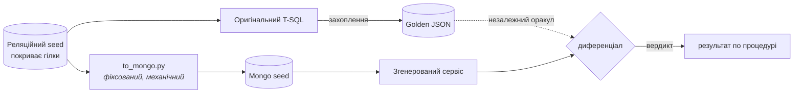
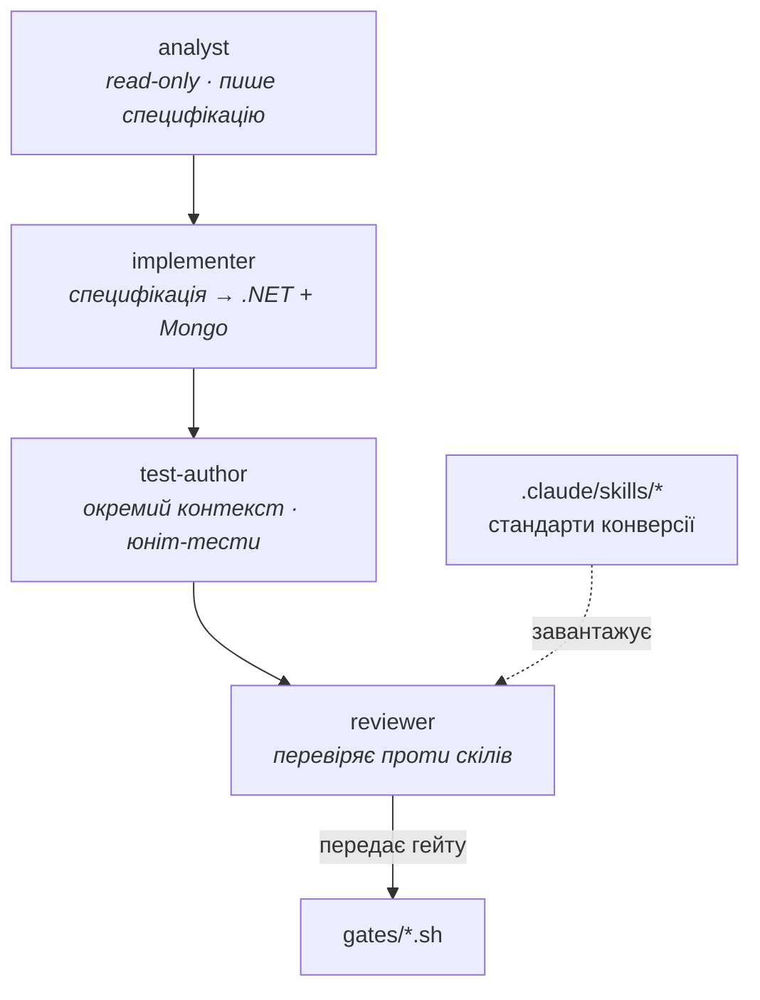
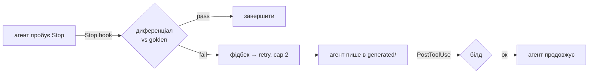

# Архітектура

Це розгортає три діаграми README в міркування за ними. README відповідає *що*; це
відповідає *чому воно так сформоване*. Це постійний документ — він переживає
таск-трекер.

Увесь дизайн служить одному твердженню: **що ненадійній моделі можна довіряти на
міграційній задачі, бо незалежний оракул ловить її помилки, а харнес міряє, що
зловив.** Кожне структурне рішення нижче — наслідок цього.

---

## 1. Форма проблеми

Конверсія T-SQL збереженої процедури в .NET + MongoDB сервіс — задача, яку модель
може легко *спробувати* й часто *тонко помилитись*: off-by-one у пагінації,
прибраний опціональний фільтр, relevance-впорядкування, що виглядає правильно, але
ні, decimal, що втрачає точність, переходячи в `Decimal128`. Жодне не падає
голосно. Усі підводять клієнта.

Тож інженерна проблема не «конвертувати» — вона «**знати, коли конверсія
неправильна**», дешево, без людини, що читає кожен рядок. Це проблема оракула, і
вона рухає все.

---

## 2. Оракул, захоплений до AI

Golden-вивід захоплено з **оригінальної процедури**, на **seed, що покриває
гілки**, **до будь-якої моделі** (ADR-0001). Це факт про оригінальну систему.
Модель не може на нього вплинути, бо його ще не існує, коли golden заморожено.

Дві тонкощі, які кодує діаграма:

- **Обидва боки походять від того самого seed.** Golden — з оригінального T-SQL
  над реляційним seed; Mongo-дані — з **фіксованої механічної міграції**
  (`to_mongo.py`) *того самого* реляційного seed (ADR-0003). Жоден бік не
  підігнаний під інший, тож порівняння лишається чесним. Якби ми писали
  Mongo-документи руками, ми б перенесли проблему оракула, не розв'язали.
- **Seed розміряний покриттям гілок, не об'ємом** (ADR-0002). Він існує, щоб кожна
  гілка давала *розрізнюваний* вихід — доведено обов'язковою мутаційною перевіркою
  (ADR-0006), не припущено.

---

## 3. Агент, стадійний на Claude Code

Чотири **субагенти** зі справді розділеним контекстом (ADR-0004), не один промпт у
циклі:

- **`analyst`** читає T-SQL і пише специфікацію *наміру*. Read-only — не пише коду,
  тож implementer стартує з розуміння, а не перекладу.
- **`implementer`** перетворює специфікацію на ідіоматичний .NET-сервіс над
  фіксованою документною моделлю Mongo.
- **`test-author`** пише юніт-тести в **окремому контексті**, тож не кодує «що було
  зручно implementer» — працює зі специфікації.
- **`reviewer`** перевіряє вихід проти **скілів** (`.claude/skills/*`) — стандартів
  конверсії як версіонованих файлів, не поради в промпті.

Стадійність — суть: розділений контекст спиняє код і його тести від спільної сліпої
плями. Це також *чому власні тести агента ніколи не проходять гейт самі* — вони
можуть помилятися в тому ж напрямку, що й код (ADR-0001).

---

## 4. Гейт, у потоці через хуки

**Хуки** (`.claude/settings.json`) роблять гейтинг властивістю циклу, не
пост-скриптом:

- **`PostToolUse`** білдить після кожного запису в `generated/` — сервіс, що не
  компілюється, ніколи не рухається далі.
- **`Stop`** ганяє диференціал до завершення агента — конверсія, що не збігається з
  golden, не може бути оголошена готовою; провал згодовується назад як структурований
  фідбек, і агент ретраїть (cap 2).
- **`PreToolUse`** блокує записи поза дозволеними теками — агент не блукає.

Самі гейт-тули — **Bash-скрипти** (ADR-0005) — той самий артефакт, який агент
викликає, хук інвокає, а рев'ювер читає. `verify.sh` компонує build + unit +
differential і відтворює опубліковані результати **без викликів моделі**, що й
робить числа аудитованими.

І авторитет гейта **доведений, не заявлений**: `mutation-check.sh` (ADR-0006,
обов'язковий) вносить відомі баги й вимагає, щоб гейт зловив кожен.

---

## 5. Харнес, що міряє чесно

> **Статус:** заплановано (Фаза 4). Гейт нижче (`verify.sh`, `mutation-check.sh`)
> існує й працює вже сьогодні; харнес вимірювання, що ганяє агента по корпусу, —
> ще ні. Цей розділ описує, що він робитиме, у тоні дизайну, а не завершеного
> прогону.

Харнес ганятиме Claude Code **headless** (`claude -p …`) раз на процедуру і
записуватиме, на процедуру: вердикт диференціала, використані retry, токени,
вартість. По `k=3` прогонах звітуватиме **розподіл**, позначатиме `flaky`-процедури
й будуватиме **таксономію провалів** — бо результат без провалів це привід
розслідувати, а не перемога. Наївний single-prompt прогін триматиметься як
**контрольний baseline**.

Єдиний артефакт, який не підробити, — **абзац аналізу** в
`evals/results/summary.md`: що спільного мали differential-провали. Написати його
правдиво потребує зробленої роботи.

---

## 6. Чому не очевидні альтернативи

- **Чому не детермінований транспайлер?** Був би *менше* AI, не більше, і не
  дістає до ідіоматичного сервісного коду чи документного моделювання. Суть —
  довіряти моделі там, куди транспайлер не дійде.
- **Чому не дати AI тестувати себе?** Циклічно — тести успадковують нерозуміння
  коду (ADR-0001).
- **Чому не писати Mongo-дані руками?** Переносить проблему оракула в підігнаний
  документний store (ADR-0003).
- **Чому не довіряти гейту за дизайном?** Бо «має зловити» це не «було показано, що
  ловить» — артефакт відмовляється від цього твердження щодо AI, тож не може його
  зробити щодо власного гейта (ADR-0006).

---

## 7. Запис рішень

| ADR | Рішення |
| --- | --- |
| [0001](adr/0001-non-circular-gate.md) | Golden захоплено до будь-якої моделі |
| [0002](adr/0002-dataset-sizing.md) | Обсяг даних за покриттям гілок, не об'ємом |
| [0003](adr/0003-mechanical-mongo-seed.md) | Mongo-seed — чиста функція реляційного seed |
| [0004](adr/0004-claude-code-substrate.md) | Побудовано на Claude Code — справжні agents/skills/hooks/tools |
| [0005](adr/0005-tools-bash-then-mcp.md) | Bash гейт-тули зараз, MCP як stretch |
| [0006](adr/0006-mutation-validation.md) | Обов'язкова мутаційна перевірка доводить, що гейт має зуби |
