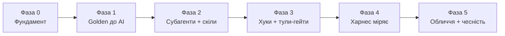

# Таск-трекер — риштування, не артефакт

Ця тека **тимчасова**. Вона існує, щоб провести `sql-to-service` від порожнього
репо до робочого харнеса. Щойно фаза завершена, її таски **видаляються або
конвертуються в де-факто імплементацію** — бо самі артефакти стають записом. Рядок
трекера — це обіцянка; файл, на який він вказує, — доказ. Коли файл існує і
проходить свій гейт, рядок зайвий.

> **Правило життєвого циклу.** Ніщо тут не є несучим після імплементації.
> - **Таск-рядки** → видаляються, щойно їх цільовий файл існує і загейтований.
> - **Дизайн-доки, що переживають білд** (ADR, архітектура) → *переносяться* в
>   `docs/`, не видаляються. Позначені `[permanent]` нижче.
> - Коли кожна фаза `done`, уся ця тека видаляється одним комітом.

Кожна таска називає **один цільовий файл** (або малий когерентний набір). «Done» —
не думка, а: *файл існує, і гейт, що його судить, зелений.*

---

## Хребет, який ми будуємо

```
Golden (до AI)  →  субагенти роблять стадійно, озброєні скілами
                →  хуки гейтять кожен перехід через тули-скрипти
                →  харнес міряє чесно.
```

Чотири фази мапляться на це одне речення. Будуй по порядку — вихід кожної фази є
входом наступної.



---

## Легенда статусів

`todo` · `wip` · `blocked` · `done` · `cut` (викинуто, з одним рядком чому)

Кожна таска несе ще **долю** — що з нею після білду:
`delete` (риштування) · `becomes-impl` (цільовий файл рядка і є deliverable)
· `permanent` (док, що лишається в `docs/`).

---

## Фаза 0 — Фундамент *(рішення заморожені до будь-якого коду)*

| # | Таска | Цільовий файл | Статус | Доля |
|---|-------|---------------|--------|------|
| 0.1 | Обрати джерело корпусу + пін (URL + SHA) | `corpus/SOURCE.md` | done | permanent |
| 0.2 | Критерій вибору + повний список кандидатів + виключення | `corpus/SELECTION.md` | done | permanent |
| 0.3 | Рішення про обсяг даних (покриття гілок, не об'єм) | `docs/adr/0002-dataset-sizing.md` | done | permanent |
| 0.4 | ADR-0001 нециклічний гейт (golden до моделі) | `docs/adr/0001-non-circular-gate.md` | done | permanent |
| 0.5 | ADR-0003 механічний Mongo-seed (чиста фн реляційного seed) | `docs/adr/0003-mechanical-mongo-seed.md` | done | permanent |
| 0.6 | ADR-0004 Claude Code як субстрат (agents/skills/hooks/tools) | `docs/adr/0004-claude-code-substrate.md` | done | permanent |
| 0.7 | ADR-0005 Bash тули-гейти зараз, MCP як stretch | `docs/adr/0005-tools-bash-then-mcp.md` | done | permanent |
| 0.8 | ADR-0006 мутаційна перевірка як валідація гейта | `docs/adr/0006-mutation-validation.md` | done | permanent |
| 0.9 | Архітектурний док (3 діаграми README, розгорнуті) | `docs/architecture.md` | done | permanent |
| 0.10 | Pre-registration: гіпотези + пороги до run-001 | `evals/PREREGISTRATION.md` | done | permanent |

> **0.2 закрито у Фазі 1:** критерій вибору заморожено у Фазі 0; повну таблицю
> кандидатів + виключення тоді заповнено `corpus/select.sql` проти відновленої БД
> (18 проходять механічний скрін, корпус = 14 `IN`, 6 base-writer-ів виключено).
> Критерій 1 уточнено з «no INSERT/UPDATE/DELETE» до «no *base-table* write», щоб
> `#temp`-only `Get*Updates` увійшли.

**Вихід Фази 0:** кожне рішення, від якого залежать пізніші фази, написане і
`Accepted`. Жодного коду пайплайну, поки це не зелене.

---

## Фаза 1 — Golden до AI *(оракул, захоплений без моделі в кімнаті)*

| # | Таска | Цільовий файл | Статус | Доля |
|---|-------|---------------|--------|------|
| 1.1 | `docker compose`: SQL Server :11433 + Mongo :37017 + healthchecks | `docker-compose.yml` | done | becomes-impl |
| 1.2 | Скрипт restore + seed (пінований .bak, SHA-перевірка, голосно-падаючий) | `corpus/restore.sh` | done | becomes-impl |
| 1.3 | Витягти обрані процедури дослівно | `corpus/procs/*.sql` | done | becomes-impl |
| 1.4 | Реляційний seed — рядки, що покривають гілки, за §0.3 | `corpus/seed/relational.sql` | done | becomes-impl |
| 1.5 | Набори параметр-кейсів на процедуру (5–8, покривають гілки) | `corpus/cases/*.json` | done | becomes-impl |
| 1.6 | Захопити golden-вивід з оригіналів | `corpus/golden/*.json`, `corpus/capture-golden.{sh,py}` | done | becomes-impl |
| 1.7 | Канонізувати golden (стабільне впорядкування, нормалізація чисел) | `corpus/canonicalise.py` | done | becomes-impl |
| 1.8 | Механічний Mongo-seed (чиста фн реляційного seed) | `corpus/seed/to_mongo.py` | done | becomes-impl |
| 1.9 | Перевірка стабільності: golden ідентичний між двома захопленнями | `gates/verify-stable.sh` | done | becomes-impl |

> **Фазу 1 будували у дві транші (ADR-0007), обидві тепер завершені.** Транша 1 —
> 11 придатних процедур — сідує 16 таблиць, що покривають гілки, і 51 golden-файл.
> **Транша 2** — 3 темпоральні процедури (`GetCustomer/Supplier/CityUpdates`) —
> тепер вкладена в той самий `relational.sql`: чотири спільні таблиці стають
> system-versioned *на місці* (migrate-existing-data, історія з фіксованими
> літералами, тож лишається детермінованою), додано lookup-виміри й історію
> `*_Archive`, а `geography` захоплюється як Well-Known-Text (`.STAsText()`),
> оскільки `FOR JSON` відмовляє CLR-типу. Процедури з temp-таблицями перемагають
> `describe_first_result_set` (помилка 11526), тож їхні case-файли несуть явний
> `resultset`, переписаний із власної `#...Changes` таблиці процедури. Результат:
> **14 процедур, 67 golden-файлів, байт-ідентичні між двома захопленнями**; golden
> транші 1 незмінний (конверсія на місці не протекла). Див. ADR-0007 «Транша 2, як
> збудовано».

**Вихід Фази 1:** golden існує, детермінований між пере-захопленнями, і вироблений
з нуль участю моделі. Це фундамент довіри — має бути правильним до будь-якого
агента.

---

## Фаза 2 — Субагенти роблять стадійно, озброєні скілами

| # | Таска | Цільовий файл | Статус | Доля |
|---|-------|---------------|--------|------|
| 2.1 | Субагент `analyst` — read-only, пише специфікацію, без коду | `.claude/agents/analyst.md` | done | becomes-impl |
| 2.2 | Субагент `implementer` — специфікація → .NET + Mongo | `.claude/agents/implementer.md` | done | becomes-impl |
| 2.3 | Субагент `test-author` — окремий контекст, пише юніт-тести | `.claude/agents/test-author.md` | done | becomes-impl |
| 2.4 | Субагент `reviewer` — перевіряє проти скілів | `.claude/agents/reviewer.md` | done | becomes-impl |
| 2.5 | Скіл: семантика T-SQL → намір сервісу | `.claude/skills/tsql-semantics/SKILL.md` | done | becomes-impl |
| 2.6 | Скіл: правила round-trip `decimal` → `Decimal128` | `.claude/skills/decimal-mapping/SKILL.md` | done | becomes-impl |
| 2.7 | Скіл: result-set → документне моделювання Mongo | `.claude/skills/document-modelling/SKILL.md` | done | becomes-impl |
| 2.8 | Скіл: ідіоматична форма .NET-сервісу | `.claude/skills/dotnet-service-shape/SKILL.md` | done | becomes-impl |
| 2.9 | Одна вітринна конверсія наскрізь (змістовний `SearchFor*`) | `generated/SearchForCustomersService.cs` | done | becomes-impl |

> **Фаза 2, як збудовано.** Чотири субагенти — справжні агенти Claude Code з
> розділеними тулсетами, не перейменовані промпти: `analyst` — read-only + Write
> (лише специфікація, без коду), `implementer` і `test-author` пишуть у
> `generated/` в окремих контекстах (щоб тести не успадкували сліпу пляму коду,
> ADR-0001), а `reviewer` **не має** Write/Edit — він читає, завантажує скіли й
> ганяє гейт. Чотири скіли — версіоновані `SKILL.md`, заземлені на реальному
> корпусі (правила вкладення FOR JSON AUTO, ковтання NULL у CONCAT,
> decimal→Decimal128 на scale 4, ідіоматична форма сервісу). Вітрина —
> `Website.SearchForCustomers`, найважча конверсія корпусу (join трьох таблиць,
> INNER-відкидає vs LEFT-зберігає, CONCAT-пошук, TOP-після-ORDER і вкладення
> FOR JSON AUTO, відтворене з пласких колекцій). Вона проходить усі чотири стадії
> вручну: `generated/Website.SearchForCustomers.spec.md` →
> `SearchForCustomersService.cs` + `Program.cs` → `tests/` → `.review.md`. Обидва
> проєкти білдяться на .NET 10, **6/6 тестів проходять**, кожен звіряє вивід
> сервісу з golden після власного `canonicalise.py` гейта — тож диференціал уже
> зелений на кожному кейсі. Standalone `gates/*.sh` і in-loop хуки — це Фаза 3.

**Вихід Фази 2:** чотири субагенти існують зі справді розділеним контекстом і
тулсетами (не перейменовані промпти), скіли — версіоновані файли, які завантажує
reviewer, і одна змістовна конверсія проходить усі чотири стадії вручну.
**Виконано:** див. «Фаза 2, як збудовано» вище.

---

## Фаза 3 — Хуки гейтять кожен перехід через тули-скрипти

| # | Таска | Цільовий файл | Статус | Доля |
|---|-------|---------------|--------|------|
| 3.1 | Тул-гейт: білд згенерованого сервісу | `gates/build.sh` | done | becomes-impl |
| 3.2 | Тул-гейт: запуск агентських юніт-тестів | `gates/unit.sh` | done | becomes-impl |
| 3.3 | Тул-гейт: диференціал проти golden (порівняння за значенням) | `gates/differential.sh` | done | becomes-impl |
| 3.4 | Тул-гейт: `verify.sh` = build+unit+diff, без викликів моделі | `gates/verify.sh` | done | becomes-impl |
| 3.5 | Хук `PostToolUse` → білд після кожного запису в `generated/` | `.claude/settings.json` | done | becomes-impl |
| 3.6 | Хук `Stop` → диференціал мусить пройти до завершення агента | `.claude/settings.json` | done | becomes-impl |
| 3.7 | Хук `PreToolUse` → блокувати записи поза дозволеними теками | `.claude/settings.json` | done | becomes-impl |
| 3.8 | Retry-фідбек: провал гейта згодовується агенту назад (cap 2) | `pipeline/retry.md` | done | becomes-impl |
| 3.9 | **Валідація гейта мутацією (ОБОВ'ЯЗКОВА)**: внести відомі баги, довести, що гейт ловить кожен | `gates/mutation-check.sh` | done | becomes-impl |

> **3.9 не опціональна і не stretch.** Диференціальний гейт, якому жодного разу не
> показали, що він падає на неправильній конверсії — це неперевірений гейт; його
> зелений нічого не вартий. Набір мутацій (прибрати `WHERE`, зламати `ORDER BY`,
> зсунути пагінацію, підмінити join) закомічений, і кожен мутант, якого гейт *не
> зловив*, — це діра в даних (див. §0.3), яку треба закрити до виходу Фази 3. Це
> артефакт, що перетворює «в нас є тести» на «ми довели, що тести мають зуби».

> **Фаза 3 як побудовано.** Чотири скрипти-гейти, три хуки, один retry-док, одна
> мутаційна перевірка.
>
> *Гейти* (`gates/*.sh`) — простий POSIX-sh, викликні хуком, людиною чи CI без
> моделі в потоці (ADR-0005). `build.sh` компілює лише `generated/` у Release і
> толерує NuGet-попередження NU1902/NU1903 (це не помилки компіляції); `unit.sh`
> ганяє написані агентом xunit-тести проти власної ізольованої БД; `differential.sh`
> несе основне навантаження — сідить Mongo, білдить **один раз**, тоді запускає
> скомпільований бінарник, щоб stdout був чистим JSON, і порівнює кожен кейс із
> golden через власний `canonicalise.py` гейта (`--ordered`, бо в процедури є
> `ORDER BY`). `verify.sh` зчіплює build→unit→diff з fail-fast. На showcase: build
> PASS, **6/6 unit, 5/5 differential**, нуль викликів моделі.
>
> *Хуки* (`.claude/settings.json`, тонкі скрипти під `.claude/hooks/`) вплітають
> гейти в цикл агента через конвенцію фідбеку exit-2: `PostToolUse` білдить після
> будь-якого запису `.cs`/`.csproj` під `generated/` і віддає поломку компіляції
> одразу назад; `Stop` блокує завершення агента, доки диференціал червоний;
> `PreToolUse` (`guard-path`) падає **закрито** — дозволяє записи лише під
> `generated/` (плюс тимчасова тека ОС) і відмовляє решті, тож зелений гейт ніколи
> не може означати «агент відредагував оракул під власний вивід» (ADR-0001/0004).
> Шляхи резолвляться через `$CLAUDE_PROJECT_DIR`; усі три перевірені pipe-тестом на
> синтетичних payload-ах виклику інструмента (дозволити `generated/`, блокувати
> `corpus/`, пропустити не-записувальні інструменти).
>
> *Протокол повторів* (`pipeline/retry.md`) ділить шлях помилки надвоє: хуки — це
> внутрішньоциклова половина (швидкі, безпам'ятні корекції), а **ліміт 2** живе в
> харнесі Фази 4, не в хуках — ліміт робить «ніколи не бреше» ще й «завжди
> завершується» і фіксує проц, що вичерпав ліміт, як чесний провал, а не крутить
> повтори, доки число не стане гарним.
>
> *Зуби* доведені, не заявлені: `gates/mutation-check.sh` вносить п'ять однорядкових
> багів у showcase-сервіс (drop-where, break-order, shift-pagination, drop-join,
> type-coercion) і вимагає, щоб диференціал почервонів на **кожному**. Усі 5
> зловлені. Єдина чесна засторога щодо охоплення: мутант ADR-0006 `decimal(18,4)→
> float` не має цілі в цій процедурі (вона не повертає decimal-колонки), тож
> `type-coercion` заміщає клас неправильного числового представлення; справжню
> втрату точності відпрацьовує конверсія процедури з грошима. Зазначено в заголовку
> скрипта, а не тихо пропущено.

**Вихід Фази 3:** кожен перехід гейтиться автоматично в потоці, диференціал має
зуби (**доведено** обов'язковою мутаційною перевіркою, що ловить кожен внесений
баг — жоден незловлений мутант блокує вихід), і `verify.sh` відтворює вердикт без
викликів моделі. **Виконано:** див. «Фаза 3 як побудовано» вище.

---

## Фаза 4 — Харнес міряє чесно

| # | Таска | Цільовий файл | Статус | Доля |
|---|-------|---------------|--------|------|
| 4.1 | Харнес: ганяти Claude Code headless на процедуру, збирати вартість | `evals/harness.py` | todo | becomes-impl |
| 4.2 | Запис результату по процедурі (вердикт + retry + токени + $) | `evals/results/run-001.json` | todo | becomes-impl |
| 4.3 | k=3 прогони; звіт розподілу, позначка `flaky` | `evals/results/run-002.json` | todo | becomes-impl |
| 4.4 | Структурований трейс прогону (аудитований заднім числом) | `evals/results/run-*.trace.jsonl` | todo | becomes-impl |
| 4.5 | Визначення метрик (модель вартості, контроль кешу, чесність малого n) | `evals/METHOD.md` | todo | permanent |
| 4.6 | Зведення: Таблиця 1 (headline) + Таблиця 2 (таксономія) + аналіз | `evals/results/summary.md` | todo | becomes-impl |
| 4.7 | Наївний single-prompt baseline (контроль) | `evals/results/baseline.json` | todo | becomes-impl |

**Вихід Фази 4:** числа походять зі справжніх headless-прогонів агента, таксономія
провалів має абзац аналізу (єдиний артефакт, який не підробити), і вивід
`verify.sh` збігається з опублікованою таблицею.

---

## Фаза 5 — Обличчя + шар чесності

| # | Таска | Цільовий файл | Статус | Доля |
|---|-------|---------------|--------|------|
| 5.1 | README: заповнити Status → результати, під'єднати ланцюг read-without-running з 4 посилань | `README.md` | wip | permanent |
| 5.2 | CI `verify.yml` (безкоштовний, без моделі) + зелений бейдж на 1-му рядку | `.github/workflows/verify.yml` | todo | becomes-impl |
| 5.3 | CI `regenerate.yml` (платний, opt-in) | `.github/workflows/regenerate.yml` | todo | becomes-impl |
| 5.4 | `SECURITY.md`: supply-chain (.bak SHA), поводження з секретами | `docs/SECURITY.md` | todo | permanent |
| 5.5 | `CHANGELOG.md` | `CHANGELOG.md` | todo | permanent |
| 5.6 | Репо public + запінене в профілі *(вручну)* | — | todo | delete |

**Вихід Фази 5:** рев'ювер, що приходить холодним, дістає вердикт за 90 секунд,
може пройти одну конверсію наскрізь нічого не запускаючи, і бачить зелений бейдж,
за який ручається GitHub, а не автор.

---

## Що ще варто зафіксувати в docs (поза тасками)

Це не білд-кроки, а рішення/записи, що не дають історії суперечити собі. Більшість
— Фаза-0 ADR вище; позначено тут, щоб жодне не загубилось:

- **Реєстр чисел.** Одне місце, де кожна цифра табульована, тож `README`,
  `summary.md` і `architecture.md` ніколи не розходяться. → `evals/METHOD.md` §canon.
- **Firewall демо-vs-реальність.** Один абзац, сказаний раз, що магнітуди демо —
  власні числа демо і не заміщають жодного реального енгейджменту. → вже в README
  «Чим це не є»; тримати як єдине джерело.
- **«Як міряється done» на фазу.** Рядки виходу вище — це контракт; коли фаза
  закривається, її рядок виходу переходить у постійний док, який вона валідувала.
- **Cut-list.** Коли таска `cut`, записати сюди один рядок чому, щоб рев'ювер не
  прочитав відсутність як недогляд.

---

## Протокол конверсії (як ця тека помирає)

1. Цільовий файл таски лягає і проходить гейт → рядок `done`.
2. Усі рядки фази `done` → видалити таск-таблицю фази; її **рядок виходу**
   копіюється в постійний док, який вона виробила (ADR / архітектура / METHOD).
3. Айтеми долі `permanent` уже в `docs/` — нічого переносити, просто перестати
   трекати їх тут.
4. Кожна фаза `done` → видалити `docs/tasks/` одним комітом з назвою
   `chore: retire task scaffolding — artifacts are the record`.

Тест на те, чи ця тека ще заслуговує існувати: *чи є хоч один рядок, істинність
якого не доводиться відкриттям файлу, на який він вказує?* Коли відповідь ні —
видалити.
